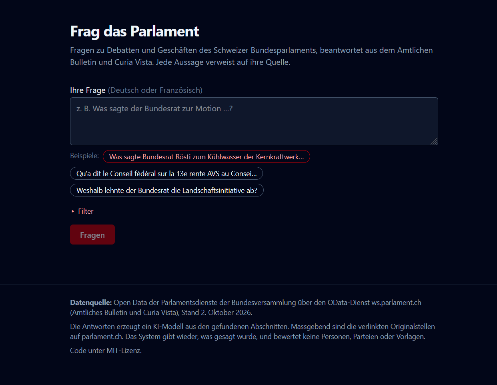
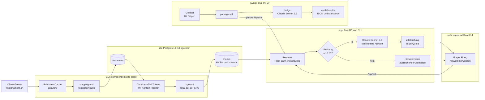

# Frag das Parlament

[](https://github.com/juandroo1/Parlament-RAG/actions/workflows/ci.yml)

RAG-Anwendung, die Fragen zu Debatten und Geschäften des Schweizer Bundesparlaments beantwortet, auf Deutsch und Französisch. Grundlage sind das Amtliche Bulletin (Wortprotokolle) und Curia Vista (Geschäfte). Jede Aussage ist mit einer überprüfbaren Quelle auf parlament.ch belegt. Die Qualität wird mit einem reproduzierbaren Eval-Set gemessen, nicht nach Gefühl beurteilt.

> **In English:** *Frag das Parlament* ("Ask Parliament") answers questions about debates and proposals in the Swiss federal parliament in German and French, with every statement linked to its source on parlament.ch. It is a retrieval-augmented generation system built on Postgres/pgvector, local multilingual embeddings and Claude, shipped as a Docker Compose stack with a FastAPI backend and a React UI. Every design choice was measured against a human-reviewed evaluation set, and the results, costs and known limits are documented below.



## Inhalt

- [Auf einen Blick](#auf-einen-blick)
- [Architektur](#architektur)
- [Ergebnisse](#ergebnisse)
- [Designentscheide](#designentscheide)
- [Kosten und Latenz](#kosten-und-latenz)
- [Bekannte Grenzen](#bekannte-grenzen)
- [Quickstart mit Docker](#quickstart-mit-docker)
- [Bedienung](#bedienung)
- [Evals](#evals)
- [Lokale Entwicklung mit uv](#lokale-entwicklung-mit-uv)
- [Datenquelle und Lizenz](#datenquelle-und-lizenz)
- [Arbeitsweise](#arbeitsweise)

## Auf einen Blick

- **Korpus:** 42'515 Dokumente (Voten und Geschäftstexte, DE und FR) aus 15 Sessionen von Dezember 2023 bis Oktober 2026, 102'891 Chunks.
- **Suche:** Vektorsuche mit dem lokalen, mehrsprachigen Modell bge-m3 in Postgres mit pgvector. Filter nach Rat, Zeitraum und Fraktion wirken schon in der Datenbank. Eine deutsche Frage findet auch französische Voten.
- **Antworten:** Claude Sonnet 5.5 antwortet in der Sprache der Frage und belegt jede Aussage mit [n]. Der Server ordnet die Nummern den Quellen zu, erfundene Quellen sind technisch ausgeschlossen. Reichen die Quellen nicht, sagt das System das klar.
- **Qualität:** 65 von Hand geprüfte Fragen. Zitiergenauigkeit 0.976, Faithfulness 0.979, Neutralität bei wertenden Fragen 1.00, Ablehnungsquote bei unbeantwortbaren Fragen 0.90 bei nur 0.02 falschen Ablehnungen.
- **Experimente:** 4 Suchverfahren, 4 Index-Varianten und 4 Sprachmodelle gemessen und entschieden, jeder Lauf mit Git-SHA unter [`evals/results/`](evals/results/).
- **Engineering:** Docker Compose mit drei Services (`db`, `app`, `web`), CI mit Lint, Typen, rund 475 Tests und Smoke-Test des Stacks; Spec-driven Development mit Entscheidungsprotokoll.

## Architektur



- **Ingest** lädt Voten und Geschäfte über den OData-Dienst, speichert jede Antwort roh im Cache und schreibt die Dokumente idempotent in die Datenbank. Der Dienst wird gedrosselt und nur einmal pro Abfrage belastet.
- **Index** zerlegt die Dokumente in Chunks. Jeder Chunk trägt einen Kopf mit Rat, Datum, Redner bzw. Geschäft und Titel und wird mit bge-m3 eingebettet. Neu oder geändert indexiert wird nur, was nötig ist.
- **Antwort:** Die besten 8 Chunks gehen als Quellen [1] bis [8] an Claude. Das Modell antwortet nach einem festen Schema mit den Nummern der Quellen; der Server prüft jede Nummer und fragt bei einem Fehler einmal nach.
- **Ein Weg für alles:** CLI (`parlrag ask`), API (`POST /ask`), Web-UI und Evals nutzen dieselbe Pipeline. Gemessen wird also genau das, was ausgeliefert wird.

Details: [`plan.md`](specs/001-frag-das-parlament/plan.md) (Architektur, Datenmodell, Entscheidungsprotokoll).

## Ergebnisse

Gemessen gegen den eingefrorenen Korpus (Stichtag 2026-10-02) auf dem Goldset v2 mit 65 Fragen. Die Retrieval-Werte stammen aus dem vollen Lauf mit Vektorsuche (`evals/results/2026-11-15_e20e749_full-vector.md`). Die Antwort-Werte stammen aus der Baseline mit allen 65 Fragen und Claude Haiku 5.5 (`evals/results/2026-11-14_a201a9c_full-vector-answers.md`). Das Standardmodell Sonnet 5.5 wurde auf der Smoke-Suite gemessen und lag dort in allen Antwort-Metriken gleich gut oder besser (siehe [Experimente](#experimente)).

| Akzeptanzkriterium | Metrik | Ziel | Gemessen | Stand |
|---|---|---|---|---|
| AK-1.1 | Antwortsprache wie die Frage | gemessen | 0.985 (64 von 65) | erfüllt |
| AK-1.2, AK-2.3 | Zitiergenauigkeit | ≥ 0.90 | 0.976 | erfüllt |
| – | Faithfulness | – | 0.979 | – |
| AK-1.3 | Antwortzeit p95 | < 10 s | 12.5 s (Sonnet, über das Abo inklusive Start der CLI) | offen, Messung mit API-Key steht aus |
| AK-3.2 | Ablehnungsquote (unbeantwortbar) | ≥ 0.90 | 0.90 (9 von 10) | erfüllt |
| AK-3.3 | Falsche Ablehnungen (beantwortbar) | ≤ 0.05 | 0.02 (1 von 50) | erfüllt |
| AK-7.1 | Neutralität (wertende Fragen) | 1.00 | 1.00 (5 von 5) | erfüllt |
| – | Recall@10 | ≥ 0.80 | 0.774 | knapp verfehlt |
| AK-5.1 | Recall@10 sprachübergreifend | ≥ 0.80 | 0.700 | verfehlt |

Recall@10 heisst: Anteil der erwarteten Quellen, die unter den ersten 10 gefundenen Dokumenten liegen. Mit Reranker würden beide Recall-Ziele erreicht (0.826 bzw. 0.800), er ist auf der CPU aber zu langsam (siehe [Experimente](#experimente)).

**Prüfung des Judge:** 51 Urteile zu 7 Antworten (≈ 10 %) wurden gegen den Wortlaut der Quellen geprüft; 47 bestätigt, Übereinstimmung 92 % (`evals/results/2026-11-14_a201a9c_judge-check.md`). Die Prüfung hat Claude Opus 5.5 vorgenommen und Sandro freigegeben; eine unabhängige Prüfung jedes Urteils von Hand steht noch aus. Der Judge war eher zu nachsichtig bei Sinnverschiebungen, die beiden Antwort-Metriken sind deshalb eher leicht überschätzt.

### Experimente

Jedes Experiment ist mit seinen Ergebnisdateien in `evals/results/` belegt, der Entscheid steht im [Entscheidungsprotokoll](specs/001-frag-das-parlament/plan.md#12-entscheidungsprotokoll). Die Standardwerte sind fett.

**Suchverfahren** (Task 3.3), Goldset v1 (`full`, 28 beantwortbare Fragen):

| Variante | Recall@10 | MRR@10 | Recall@10 sprachübergreifend | Suche p95 |
|---|---|---|---|---|
| nur Volltext | 0.399 | 0.270 | 0.000 | 1771 ms |
| **nur Vektor** | **0.780** | **0.541** | **0.600** | **536 ms** |
| Hybrid (RRF) | 0.637 | 0.424 | 0.000 | 1246 ms |

Die Volltextsuche rankt ohne IDF, deshalb dominieren häufige Wörter wie «Bundesrat». Über RRF verdrängen diese Treffer gute Vektortreffer, besonders die in der anderen Sprache.

**Reranker** (Task 6.1a), Goldset v2 (`full`, 55 beantwortbare Fragen). Der Cross-Encoder [BAAI/bge-reranker-v2-m3](https://huggingface.co/BAAI/bge-reranker-v2-m3) sortiert die besten Vektortreffer neu, lokal auf der CPU:

| Variante | Recall@10 | MRR@10 | Recall@10 sprachübergreifend | Recall@10 wertend | Suche p95 |
|---|---|---|---|---|---|
| **nur Vektor** | **0.774** | **0.609** | **0.700** | **0.367** | **1.0 s** |
| + Reranker, 30 Kandidaten, 512 Tokens | 0.826 | 0.596 | 0.800 | 0.200 | 28.9 s |
| + Reranker, 15 Kandidaten, 256 Tokens | 0.786 | 0.579 | 0.700 | 0.333 | 12.4 s |

Mit 30 Kandidaten erreicht der Reranker beide Recall-Ziele, braucht auf der CPU aber rund 0,9 s pro Kandidat; schon die Suche allein überschreitet das Ziel p95 < 10 s für die ganze Antwort. Die günstigere Variante ist immer noch zu langsam und bringt kaum Gewinn. Der Reranker bleibt deshalb ausgeschaltet (`RETRIEVAL_RERANK=false`), lässt sich für Experimente aber einschalten (`RERANK_CANDIDATES`, `RERANKER_MAX_LENGTH`; rund 2,2 GB im Volume `hf-cache` und 2,3 GB zusätzlicher Arbeitsspeicher).

**Index-Varianten** (Task 6.1b), Teilkorpus Herbstsession 2026 (4'133 Dokumente) mit den 23 Fragen des Teilsets `teilkorpus`, jede Variante in einer eigenen Experiment-Datenbank:

| Variante | Chunks | Recall@5 | Recall@10 | Recall@20 | MRR@10 | Recall@10 sprachübergreifend (n = 4) |
|---|---|---|---|---|---|---|
| **~500 Tokens mit Kontext-Header** | **10'477** | **0.667** | **0.833** | **0.920** | **0.582** | **0.500** |
| ~500 Tokens ohne Kontext-Header | 10'477 | 0.623 | 0.717 | 0.826 | 0.547 | 0.250 |
| ~300 Tokens mit Kontext-Header | 13'527 | 0.688 | 0.732 | 0.906 | 0.515 | 0.250 |
| ~800 Tokens mit Kontext-Header | 8'928 | 0.638 | 0.725 | 0.906 | 0.521 | 0.250 |

Der Kontext-Header bringt am meisten: Ohne ihn sinkt Recall@10 um 0.116. Kleinere oder grössere Chunks verlieren je rund 0.10. Mit 23 Fragen sind die Werte grob (eine Frage ≈ 0.04 Recall@10), der Abstand zeigt aber bei allen drei Varianten in dieselbe Richtung. Auf dem kleinen Teilkorpus liegen die Werte höher als auf dem ganzen Korpus; aussagekräftig ist nur der Vergleich. Ein API-Embedding-Modell wurde nicht gemessen: Anthropic bietet keine Embeddings an, ein Anbieter wie Voyage AI bräuchte einen eigenen API-Key, und für einen fairen Vergleich müsste der ganze Korpus neu indexiert werden.

**Antwort-Modell** (Task 6.1c), Smoke-Suite (15 Fragen, davon 13 beantwortet und 2 korrekt abgelehnt) über das Claude-Abo, Judge Claude Sonnet 5.5 (`medium`):

| Modell (Effort) | Zitiergenauigkeit | Faithfulness | Antwortzeit p50 | Antwortzeit p95 | Kosten pro Antwort mit API-Key |
|---|---|---|---|---|---|
| Opus 5.5 (`high`, bis 6.1c Standard) | 0.983 | 1.000 | 10.5 s | 19.7 s | 0.055 USD |
| Opus 5.5 (`low`) | 0.976 | 0.985 | 7.7 s | 10.2 s | 0.048 USD |
| **Sonnet 5.5 (`medium`)** | **0.990** | **0.995** | **6.4 s** | **12.5 s** | **0.025 USD** |
| Haiku 5.5 (`low`) | 0.963 | 0.974 | 6.9 s | 14.6 s | 0.0016 USD |

Ablehnungsquote, falsche Ablehnungen, Neutralität und Antwortsprache sind bei allen vier Modellen fehlerfrei. Die Qualität liegt nah beisammen; mit 13 Antworten sind Unterschiede von wenigen Hundertsteln Rauschen, und Sonnet bewertet als Judge auch die eigenen Antworten. Deutlich sind die Unterschiede bei Antwortzeit und Kosten. Die Kosten sind aus den Tokens zu Listenpreisen gerechnet, ohne Prompt-Caching; die Schätzungen von Claude Code in den Ergebnisdateien sind vom Cache verzerrt (der Lauf mit Opus `high` las den Cache des Laufs mit Opus `low`).

## Designentscheide

Die wichtigsten Entscheide, jeweils mit dem Grund. Alle Entscheide samt Datum stehen im [Entscheidungsprotokoll](specs/001-frag-das-parlament/plan.md#12-entscheidungsprotokoll).

1. **Nur Vektorsuche statt hybrider Suche.** Gemessen: Die hybride Suche war schlechter, weil die Volltextsuche von Postgres ohne IDF rankt. Die Modi `fulltext` und `hybrid` bleiben für Experimente erhalten.
2. **Kein Reranker im Standard.** Er hebt Recall@10 um 0.05, kostet auf der CPU aber rund 28 s pro Suche. Mit GPU oder als API-Dienst wäre er neu zu prüfen.
3. **Chunks mit rund 500 Tokens und Kontext-Header.** Der Kopf mit Rat, Datum, Redner bzw. Geschäft und Titel gibt jedem Abschnitt den Zusammenhang, der im Text selbst oft fehlt. Gemessen besser als 300 oder 800 Tokens und als ohne Kopf.
4. **Lokales, mehrsprachiges Embedding-Modell (bge-m3).** Deutsche und französische Texte liegen im selben Vektorraum, damit findet eine deutsche Frage auch französische Voten. Keine laufenden Kosten, MIT-Lizenz.
5. **Zitate nur als Nummern.** Das Modell sieht keine IDs, es liefert nur die Nummern [n] der übergebenen Quellen. Der Server ordnet sie zu und prüft sie; bei einem Fehler fragt er einmal nach. So sind erfundene Quellen technisch ausgeschlossen (AK-2.3).
6. **Schwelle auf der Cosine-Similarity.** Liegt der beste Treffer unter 0.55, gibt es keinen LLM-Aufruf, sondern einen klaren Hinweis. Darüber entscheidet zusätzlich das Modell. Der RRF-Score taugt nicht als Schwelle, weil er nur vom Rang abhängt; der Wert 0.55 ist auf dem Goldset kalibriert.
7. **Strukturierte Ausgabe.** Antwort und Judge antworten nach einem Pydantic-Schema. Es gibt kein Parsen von Freitext.
8. **Claude Sonnet 5.5 als Standard.** Im Vergleich gleich gut wie Opus, aber schneller und zum halben Preis. Modell und Effort sind über `.env` einstellbar.
9. **Zwei Zugänge zum LLM.** Container, API und Demo nutzen einen API-Key. Für die eigene Entwicklung geht auch das Claude-Abo über die Claude-Code-CLI, ohne Kosten pro Aufruf. Andere Personen über ein Abo zu bedienen, erlaubt Anthropic nicht.
10. **Reproduzierbare Evals.** Der Korpus ist auf einen Stichtag eingefroren. Das Goldset hat ein Mensch geprüft, und jeder Lauf speichert Git-SHA, Konfiguration und Korpus-Stand. Die Ergebnisse sind committet und bilden die Historie.
11. **Docker als Referenz.** Ein Image für API und CLI, Non-Root, Ports nur auf `127.0.0.1`, Schema-Migration beim Start, Modelle im Volume statt im Image. Die CI baut den ganzen Stack und prüft ihn mit einem Smoke-Test.

## Kosten und Latenz

**Pro Frage** (mit API-Key, Listenpreise, ohne Caching; im Mittel rund 8'500 Input- und 750 Output-Tokens):

| Modell | pro Frage | 1'000 Fragen |
|---|---|---|
| **Sonnet 5.5 (`medium`, Standard)** | **0.025 USD** | **25 USD** |
| Haiku 5.5 (`low`) | 0.0016 USD | 1.60 USD |
| Opus 5.5 (`high`) | 0.055 USD | 55 USD |

Fragen ohne ausreichende Grundlage unter der Schwelle kosten nichts, weil sie das LLM nicht erreichen. Die Embeddings laufen lokal und kosten ebenfalls nichts.

**Evals:** Retrieval-Evals sind kostenlos. Mit Antworten kommt pro Frage ein Urteil des Judge dazu (Sonnet, rund 0.028 USD). Ein Smoke-Lauf mit Antworten kostet mit API-Key damit rund 0.80 USD, ein voller Lauf mit 65 Fragen rund 3 USD. Während der Entwicklung liefen die Evals über das Claude-Abo.

**Latenz:**

| Schritt | Wert |
|---|---|
| Suche (ganzer Korpus, CPU) | p50 0.4 s, p95 1.0 s |
| Antwort mit Sonnet über das Abo | p50 6.4 s, p95 12.5 s (inklusive rund 1,5 s Start der CLI) |
| Erste Anfrage nach dem Start | rund 7 s zusätzlich (Embedding-Modell lädt) |

**Infrastruktur:** Der volle Index braucht auf der CPU rund 17 Stunden (1,7 Chunks/s), eine Session rund 1,5 Stunden. Die Datenbank belegt danach 1,7 GB, das Embedding-Modell rund 4 GB im Volume `hf-cache`. Beim Einbetten braucht der Container rund 4 GB Arbeitsspeicher.

## Bekannte Grenzen

- **Antwortzeit (AK-1.3) nicht belegt.** Über das Abo liegt p95 bei 12,5 s, inklusive Start der CLI. Eine Messung mit API-Key steht aus.
- **Recall unter dem Ziel.** Recall@10 liegt bei 0.774, sprachübergreifend bei 0.700 (Ziel je 0.80). Der Reranker würde beide Ziele erreichen, ist auf der CPU aber zu langsam.
- **Kleine Stichproben.** 65 Fragen im Goldset, 15 in der Smoke-Suite, 23 im Teilkorpus. Unterschiede von wenigen Hundertsteln sind Rauschen.
- **Judge mit Schwächen.** Sonnet bewertet als Judge auch die eigenen Antworten, und er war bei Sinnverschiebungen eher nachsichtig. Die Prüfung des Judge hat Claude vorgenommen, nicht eine unabhängige Person.
- **Eingefrorener Korpus.** Stand 2. Oktober 2026; neuere Sessionen fehlen, bis der Ingest erneut läuft. Ingest und Index sind inkrementell, der Stand ist aber nicht automatisiert.
- **Nur Deutsch und Französisch.** Italienische Voten und rätoromanische Texte fehlen. Die Oberfläche ist auf Deutsch.
- **Volltextsuche ohne IDF.** Eine hybride Suche bräuchte BM25 oder eine eigene Gewichtung.
- **Keine Folgefragen.** Jede Frage wird für sich beantwortet.
- **Nutzungsbedingungen der Daten** für eine öffentliche Demo sind noch nicht abschliessend geprüft.
- **Rechenzeit.** Ohne GPU dauern Indexierung und Experimente mit neuen Varianten Stunden.

Offene Ideen für spätere Versionen stehen in der [Spec unter «Offene Fragen»](specs/001-frag-das-parlament/spec.md).

## Quickstart mit Docker

Voraussetzungen: Docker mit Docker Compose und Git.

```bash
git clone https://github.com/juandroo1/Parlament-RAG.git
cd Parlament-RAG
cp .env.example .env              # Werte eintragen
docker compose up -d --build      # Datenbank (Postgres + pgvector), API und Web-UI starten
docker compose ps                 # alle drei Services sollten "healthy" sein
curl http://127.0.0.1:8000/health # {"status":"ok","database":"ok"}
docker compose down               # stoppen (Daten bleiben im Volume)
```

Die Web-UI läuft danach unter **http://127.0.0.1:8080** (Service `web`: nginx liefert die React-App aus und leitet `/api` an die API weiter). Für Antworten braucht die API im Container einen `ANTHROPIC_API_KEY`; ohne Key zeigt die UI eine klare Meldung. Wer stattdessen das eigene Claude-Abo nutzen will, startet die API lokal mit `LLM_BACKEND=claude-code` (siehe [Zugang zum LLM](#zugang-zum-llm) und [Web-UI (Entwicklung)](#web-ui-entwicklung)).

Beim Start von `app` (und bei jedem `docker compose run --rm app ...`) bringt ein Entrypoint das Datenbankschema per Alembic auf den neuesten Stand. Die Ports sind nur lokal erreichbar: Web-UI auf `127.0.0.1:8080`, API auf `127.0.0.1:8000`, Datenbank auf `127.0.0.1:5432`. Läuft auf dem Rechner bereits ein anderes Postgres auf Port 5432, in `.env` z. B. `POSTGRES_PORT=5433` setzen.

### Daten laden

```bash
docker compose run --rm app parlrag ingest --since 2026-09-15 --until 2026-09-15   # ein Sitzungstag
docker compose run --rm app parlrag ingest                                         # ab 2023-12-01 bis heute
docker compose run --rm app parlrag ingest --lang fr --refresh                     # nur FR, Cache umgehen
```

Der Ingest ist idempotent: Ein zweiter Lauf ändert nichts, geänderte Inhalte werden erkannt und aktualisiert. Pro Session wird committet, ein abgebrochener Lauf kann einfach neu gestartet werden. Antworten des OData-Dienstes werden roh in `./data/raw/` zwischengespeichert (nicht im Repo). Jede Abfrage geht damit nur einmal an den Dienst; Requests sind gedrosselt (Standard: höchstens einer pro Sekunde) und werden bei Fehlern mit Backoff wiederholt.

```bash
docker compose run --rm app parlrag stats                    # Umfang, Textlängen, Verteilung, Qualität
docker compose run --rm app parlrag stats --session-id 5215  # nur eine Session
```

Beispiel Herbstsession 2026: 2'427 Voten (1'737 DE, 690 FR) und 853 Geschäfte je Sprache, geladen in 105 Sekunden.

### Indexieren

```bash
docker compose run --rm app parlrag index --session-id 5215 --limit 40   # Test: 40 Dokumente
docker compose run --rm app parlrag index --session-id 5215              # eine Session (rund 1,5 Stunden)
docker compose run --rm app parlrag index                                # alles Offene
```

`parlrag index` chunkt neue oder geänderte Dokumente, bettet sie ein und speichert die Chunks mit Vektor. Es ist inkrementell und kann jederzeit abgebrochen und neu gestartet werden (Commit alle 32 Dokumente). Ändert sich eine Einstellung wie `CHUNK_TARGET_TOKENS` oder `INDEX_CONTEXT_HEADER`, indexiert der nächste Lauf die betroffenen Dokumente neu.

Das Embedding-Modell [BAAI/bge-m3](https://huggingface.co/BAAI/bge-m3) (MIT-Lizenz) läuft lokal auf der CPU. Es wird beim ersten Gebrauch heruntergeladen (rund 4 GB im Docker-Volume `hf-cache`) und nicht ins Image gebacken.

### Korpus-Stand

Der Korpus für die Evals ist auf den **Stichtag 2026-10-02** eingefroren (Ende der Herbstsession 2026): 15 Sessions seit der Wintersession 2023, 42'515 Dokumente (26'401 Voten, 8'057 Geschäfte je Sprache) und 102'891 Chunks. Experimente laufen auf dem Teilkorpus Herbstsession 2026 (`--session-id 5215`). Den gleichen Stand erzeugen:

```bash
docker compose run --rm app parlrag ingest --since 2023-12-01 --until 2026-10-02   # rund 20 Minuten
```

Der volle Index läuft am besten losgelöst im Hintergrund, zuerst der Teilkorpus, dann der Rest:

```bash
docker compose run -d --name parlrag-index app sh -c "parlrag index --session-id 5215 && parlrag index"
docker logs -f parlrag-index     # Fortschritt
docker stop parlrag-index        # anhalten; mit demselben Befehl fortsetzen (vorher docker rm parlrag-index)
```

Laufzeiten und Grössen im Detail: [`plan.md`, Abschnitt 3](specs/001-frag-das-parlament/plan.md).

## Bedienung

### Suchen (nur Retrieval)

```bash
docker compose run --rm app parlrag search "Was sagte der Bundesrat zu den PFAS-Grenzwerten?"
docker compose run --rm app parlrag search "PFAS" --mode fulltext --council SR --top 5
docker compose run --rm app parlrag search "PFAS" --parl-group RL --date-from 2026-09-01 --date-to 2026-09-30
docker compose run --rm app parlrag search "PFAS" --json
```

Standard ist die Vektorsuche (`--mode vector`, einstellbar über `RETRIEVAL_MODE` in `.env`). `fulltext` nutzt nur die Volltextsuche, `hybrid` kombiniert beide mit Reciprocal Rank Fusion. Ein Reranker lässt sich mit `RETRIEVAL_RERANK=true` zuschalten. Filter wirken vor der Suche. Jeder Treffer zeigt die Dokument-ID im Goldset-Format (`transcript:418982`), die Scores, Redner und Fraktion bzw. Geschäftsnummer, Rat, Datum, einen Ausschnitt und den Link auf parlament.ch.

### Fragen stellen

```bash
docker compose run --rm app parlrag ask "Was sagte Bundesrat Rösti zum Kühlwasser der Kernkraftwerke?"
docker compose run --rm app parlrag ask "Qu'a dit le Conseil fédéral sur la 13e rente AVS ?" --council SR
uv run parlrag ask "Frage" --json        # lokal, z. B. mit LLM_BACKEND=claude-code (siehe «Zugang zum LLM»)
```

Die Antwort kommt in der Sprache der Frage. Jede Aussage ist mit [n] belegt, darunter stehen die zitierten Quellen mit Redner, Fraktion, Rat, Datum, Geschäftsnummer, Ausschnitt und Link auf parlament.ch. Die Filter sind dieselben wie bei `search`. Reichen die Quellen nicht, erscheint statt einer Antwort ein klarer Hinweis samt Grund (keine Treffer, Similarity unter `ANSWER_MIN_SIMILARITY` oder Einschätzung des Modells). Die letzten Zeilen zeigen Modell, Tokens, Kosten und die Zeiten für Suche und LLM. Im Container braucht `ask` einen `ANTHROPIC_API_KEY`.

### API

Die API läuft im Container auf `127.0.0.1:8000`. Die Dokumentation der Schnittstelle liegt unter `http://127.0.0.1:8000/docs`.

```bash
curl -X POST http://127.0.0.1:8000/ask -H "Content-Type: application/json"   -d '{"question": "Was sagte Bundesrat Rösti zum Kühlwasser der Kernkraftwerke?", "filters": {"council": "NR"}}'
```

Die Antwort enthält `answer` mit den Belegen [n], `sources` (pro Nummer Dokument-ID, Redner, Fraktion, Kanton, Rat, Datum, Geschäftsnummern, Abschnitt, Ausschnitt und Link), `insufficient_context` mit Grund und `usage` (Modell, Input- und Output-Tokens, Kosten in USD, Dauer der Anfrage). Die Filter sind dieselben wie bei `search`. Fehlt der API-Key oder ist das LLM nicht erreichbar, antwortet die API mit 503 und einer Meldung, bei einer ungültigen Antwort des Modells mit 502, bei einer Ablehnung durch das Modell mit 422. Jede Antwort trägt den Header `X-Request-ID`. Pro Anfrage schreibt die API eine Logzeile `ask_request` mit Tokens, Kosten und Dauer, ohne den Wortlaut der Frage.

### Web-UI

Die Oberfläche (http://127.0.0.1:8080) zeigt Frage mit Beispielen, Filter (Rat, Zeitraum, Fraktion), die Antwort mit klickbaren Belegen [n] und die Quellen mit Redner, Rat, Datum, Geschäftsnummer, Ausschnitt und Link auf parlament.ch, dazu Datenquelle und Lizenz.

## Evals

Das Goldset [`evals/datasets/golden.jsonl`](evals/datasets/golden.jsonl) enthält 65 Fragen mit den erwarteten Quellen (Goldset v2): 40 beantwortbare auf Deutsch, 10 auf Französisch, 10 unbeantwortbare und 5 wertende; davon 10 sprachübergreifend, 8 mit Filter und 23 auf dem Teilkorpus Herbstsession 2026. Die Smoke-Suite (15 Fragen) ist seit v1 unverändert, damit ihre Läufe vergleichbar bleiben. Claude hat die Fragen aus dem Korpus vorgeschlagen, Sandro hat jede Frage geprüft. Schema, Tags und Regeln stehen in [`evals/datasets/README.md`](evals/datasets/README.md).

Die Evals laufen nur lokal mit uv, nicht im Container. So steht der Git-SHA zur Verfügung. Die Datenbank läuft dabei im Container:

```bash
uv run parlrag eval --suite smoke                  # 15 Fragen, Standard-Suchart (vector)
uv run parlrag eval --suite full --mode fulltext   # alle Fragen, nur Volltext
uv run parlrag eval --suite full --compare evals/results/<lauf>.json
uv run parlrag eval --suite smoke --answers        # mit Antworten und Judge (LLM-Aufrufe)
uv run parlrag eval --suite full --tag teilkorpus --label c300   # nur ein Teilset, Variante im Dateinamen
```

Gemessen werden Recall@5, @10 und @20 sowie MRR@10, auf Dokumenten statt Chunks. Dazu kommt die Suchdauer p50/p95, jeweils insgesamt und pro Teilset (`de`, `fr`, `crosslingual`, `filter`, `teilkorpus`, `wertend`). Jeder Lauf schreibt `evals/results/<datum>_<sha>_<suite>-<modus>.json` mit Konfiguration und Korpus-Stand, dazu eine Markdown-Zusammenfassung; Tag, Reranker, Label und Antworten ergänzen den Namen (z. B. `…_smoke-vector-sonnet-medium-answers.json`). Die Ausgabe zeigt pro Metrik die Differenz zum letzten Lauf gleicher Art und listet die Fragen, deren erwartete Quellen nicht unter den Top 10 liegen. Dazu kommt die Wirkung der Schwelle für «keine ausreichende Grundlage» (`ANSWER_MIN_SIMILARITY`): wie viele unbeantwortbare Fragen sie ohne LLM abfängt und wie viele beantwortbare sie fälschlich abweist.

Mit `--answers` erzeugt der Lauf zusätzlich für jede Frage eine Antwort (wie `parlrag ask`) und lässt sie von einem Judge-Modell (`JUDGE_MODEL`, Standard Sonnet 5.5) bewerten. Ausgewiesen werden Zitiergenauigkeit, Faithfulness, Ablehnungsquote bei unbeantwortbaren Fragen, falsche Ablehnungen, Neutralität bei wertenden Fragen, Antwortsprache, Antwortzeit p50/p95 und Kosten pro Frage. Bricht ein Lauf ab (z. B. am Limit des Abos), setzt `--resume <lauf>.json` ihn fort.

**Experiment-Datenbanken nachbauen** (Task 6.1b; Datenbank im Container, Evals lokal, Indexieren rund 1,5 bis 2 Stunden pro Variante auf der CPU):

```bash
scripts/experiment_db.sh parlrag_exp_base chunks      # Teilkorpus samt Chunks aus der Hauptdatenbank
scripts/experiment_db.sh parlrag_exp_c300             # nur die Dokumente, danach indexieren
docker compose run --rm -e POSTGRES_DB=parlrag_exp_c300 -e CHUNK_TARGET_TOKENS=300 app parlrag index
POSTGRES_DB=parlrag_exp_c300 CHUNK_TARGET_TOKENS=300 uv run parlrag eval --suite full --tag teilkorpus --label c300
```

## Lokale Entwicklung mit uv

Voraussetzung: [uv](https://docs.astral.sh/uv/). Python 3.12 installiert uv bei Bedarf selbst. Die Datenbank läuft auch dann im Container.

```bash
uv sync                           # Abhängigkeiten installieren
docker compose up -d db           # nur die Datenbank
uv run alembic upgrade head       # Schema migrieren
uv run pytest                     # Tests (DB-Tests nutzen eine eigene Datenbank parlrag_test)
uv run ruff check . && uv run ruff format --check .
uv run mypy src tests
uv run uvicorn parlrag.api.main:app --reload   # API lokal
```

Blockiert eine Windows-Richtlinie die Programmdateien in `.venv` (z. B. die intelligente App-Steuerung), laufen die Werkzeuge auch als Modul: `uv run python -m pytest`, `uv run python -m mypy src tests`.

### Zugang zum LLM

Für die Antworten nutzt die Anwendung Claude. Es gibt zwei Wege, gewählt über `LLM_BACKEND` in `.env`:

| `LLM_BACKEND` | Zugang | Wo | Kosten |
|---|---|---|---|
| `api` (Standard) | `ANTHROPIC_API_KEY` von [platform.claude.com](https://platform.claude.com) | überall, auch im Container und für die Demo | nach Verbrauch |
| `claude-code` | eigenes Claude-Abo über die installierte [Claude-Code-CLI](https://code.claude.com) (`claude` einmal starten und anmelden) | nur lokal mit uv | im Abo enthalten, mit dessen Limits |

`ANTHROPIC_MODEL` und `ANTHROPIC_EFFORT` gelten für beide Wege (Standard: `claude-sonnet-5-5` mit `medium`). Für günstige Versuche von Hand reicht `ANTHROPIC_MODEL=claude-haiku-5-5`.

Das Abo ist nur für die eigene Nutzung gedacht. Anthropic erlaubt nicht, andere Personen über ein Abo zu bedienen oder ein claude.ai-Login in einer eigenen Anwendung anzubieten. Eine öffentliche Demo läuft deshalb immer mit `api`. Beim Abo sind die ausgewiesenen Kosten eine Schätzung von Claude Code und werden nicht verrechnet. Die Latenz enthält zusätzlich den Start der CLI (rund 1,5 s).

### Web-UI (Entwicklung)

Voraussetzung: [Node.js](https://nodejs.org/) 24. Die API muss laufen (Container oder `uv run uvicorn parlrag.api.main:app`).

```bash
cd web
npm install
npm run dev          # http://127.0.0.1:5173, leitet /api an http://127.0.0.1:8000 weiter
npm test             # Vitest
npm run build        # Typprüfung und Build nach web/dist
```

Eine andere API-Adresse setzt `API_TARGET`, z. B. `API_TARGET=http://127.0.0.1:8011 npm run dev`. Im Container liefert der Service `web` die gebaute App über nginx aus (http://127.0.0.1:8080).

## Datenquelle und Lizenz

- Daten: Open Data der Parlamentsdienste der Bundesversammlung über den OData-Dienst [ws.parlament.ch](https://ws.parlament.ch/odata.svc/) (Amtliches Bulletin, Curia Vista). Die Nutzungsbedingungen für eine öffentliche Demo werden noch geprüft (siehe offene Fragen in der Spec).
- Embedding-Modell: [BAAI/bge-m3](https://huggingface.co/BAAI/bge-m3), MIT-Lizenz.
- Code: [MIT-Lizenz](LICENSE).

## Arbeitsweise

Das Projekt folgt **Spec-driven Development**. Die Quelle der Wahrheit liegt in [`specs/001-frag-das-parlament/`](specs/001-frag-das-parlament/):

- [`spec.md`](specs/001-frag-das-parlament/spec.md): Was und Warum, User Stories mit Akzeptanzkriterien, Qualitätsziele, Nicht-Ziele, offene Fragen
- [`plan.md`](specs/001-frag-das-parlament/plan.md): Architektur, Stack, Datenmodell, Eval-Konzept und das Entscheidungsprotokoll
- [`tasks.md`](specs/001-frag-das-parlament/tasks.md): Umsetzungsschritte mit Checkboxen

Der Ablauf pro Task:

1. Den Task in `tasks.md` lesen, die betroffenen Akzeptanzkriterien zusammenfassen und einen Plan zur Freigabe vorlegen.
2. Auf einem eigenen Branch umsetzen, mit Tests für die Akzeptanzkriterien. Betrifft der Task Chunking, Retrieval, Prompts oder das Modell, gehört ein Eval-Lauf dazu.
3. Abweichungen vom Plan zuerst im Entscheidungsprotokoll festhalten, dann umsetzen. Ideen ausserhalb der Spec kommen unter «Offene Fragen».
4. Pull Request mit Beschreibung, Testergebnis und Eval-Ergebnis; gemergt wird erst nach grüner CI.

Der Ablauf ist als Befehl [`/next-task`](.claude/commands/next-task.md) für [Claude Code](https://code.claude.com) festgehalten, die Regeln für den Assistenten in [`CLAUDE.md`](CLAUDE.md). Code, Tests und Dokumentation sind mit Claude Code als Pair-Programmer entstanden. Sandro hat jeden Plan freigegeben, jede Frage des Goldsets geprüft, jeden Pull Request gereviewt und gemergt. Wo Claude selbst geprüft hat, etwa beim Judge, ist das als solches ausgewiesen.
